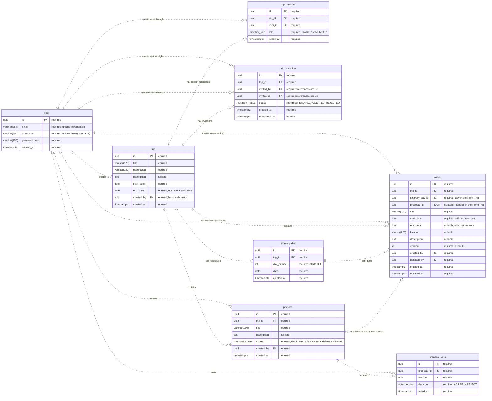

# P0 Database ER Diagram

Reference date: 2026-10-27. This is the P0 target design, not a claim that all tables have been implemented. Current frozen contracts remain authoritative.

## Current implementation

- Implemented tables: `user`, `trip`, `trip_member`, and `itinerary_day`.
- Invitations, Activities, Proposals, and Votes below are planned P0 tables.
- Trip creation now saves Owner membership and all Days atomically; member-scoped list, detail, and Days APIs are implemented.
- Database constraints are verified in `backend/test/database/trip.db-spec.ts`.

[View the SVG diagram](p0-database-erd.svg). The diagram shows the full P0 target.

## Sources

- [P0 Business Rules](https://app.notion.com/p/3f16209d54d981afb5e6e8b29b643839)
- [Domain Model](../contracts/02-DOMAIN_MODEL.md)
- [Database Contract](../contracts/04-DATABASE_CONTRACT.md)

## Diagram

Table and column names match the physical database contract. PostgreSQL enum names are shown as field types. UUID foreign keys reference the corresponding table's id.

## Reading the diagram

- PK: primary key. FK: foreign key. UK: unique key.
- required: NOT NULL; nullable: NULL is allowed.
- Exactly one is shown as `||`, zero or one as `o|` / `|o`, zero or more as `o{`, and one or more as `|{`.
- Dashed lines show non-identifying FK relationships: each child has its own UUID primary key.
- A Day may have no Activities. An Activity must belong to one Day.
- An Activity may be created directly without a Proposal. A Proposal has at most one current linked Activity.
- Trip's one-or-more Memberships/Days represent committed business invariants guaranteed by the creation transaction, not by a foreign key alone.

## Required constraints and lifecycle rules

| Area | Required rule |
| --- | --- |
| User identity | Unique lower(email) and lower(username); trim before lookup/storage. Ordinary case-sensitive uniqueness alone is insufficient. |
| Trip dates | end_date >= start_date. API creation is limited to 365 days inclusive, checked before generating Days. Base fields are immutable in P0. |
| Membership | UNIQUE(trip_id, user_id); at most one OWNER enforced in the database. Creation guarantees exactly one OWNER. Current role, not trip.created_by, determines authority. |
| Pending Invitation | At most one PENDING row per (trip_id, invitee_id), using a partial unique constraint/index. Resolved historical Invitations may remain, and re-invitation after rejection is allowed. |
| Days | UNIQUE(trip_id, date), UNIQUE(trip_id, day_number), day_number >= 1. Generate all dates in the Trip range, inclusive, in the Trip creation transaction. No Day CRUD. |
| Activity relationships | Day and optional Proposal must belong to the Activity's Trip; separate ID foreign keys alone do not enforce this. |
| Activity time/version | end_time IS NULL OR end_time >= start_time; no crossing midnight. Overlap is allowed. PATCH matches expectedVersion, increments version, and sets latest editor/time; DELETE has no version requirement. |
| Proposal origin | UNIQUE(activity.proposal_id), with NULL allowed for direct Activities. The diagram's uniqueness does not by itself synchronize Proposal status and Activity existence. |
| Votes | UNIQUE(proposal_id, user_id). Absence means not voted; no persisted PENDING decision or retract-to-no-vote action. |
| Adoption | Only manual PENDING -> ACCEPTED after rechecking current membership and AGREE > current participant count / 2. Atomically create one linked Activity and change status. |
| Reopening | Deleting a Proposal-sourced Activity atomically changes ACCEPTED -> PENDING and preserves existing Votes. Re-adoption rechecks the current majority. |
| REJECT | A Vote decision only. It never automatically closes a Proposal. Proposal status has no REJECTED value; Invitation status still does. |
| Member Leave | Delete the departing user's Trip Votes and Membership atomically; retain historical Activities/Proposals and immediately revoke access. OWNER cannot Leave. |
| Trip deletion | Remove Memberships, Invitations, Days, Activities, Proposals, and their Votes; preserve User accounts. |
| Realtime | Publish successful changes only after transaction commit. |

The ER diagram records structure. Conditional lifecycle consistency, membership permissions, transaction rollback, and after-commit broadcasting also require backend logic and appropriate tests. Do not infer SQL enforcement solely from a line or label.

## Changes from the old prototype

- Remove trip.updated_at and trip_member.is_new.
- Use trip_invitation.invited_by instead of inviter_id; add nullable responded_at.
- Add itinerary_day.created_at and both Day uniqueness constraints.
- Proposal has PENDING / ACCEPTED only; remove VOTING, REJECTED, updated_by, and updated_at.
- Show both Invitation user roles and both Activity editor roles separately.
- Correct Day -> Activity to zero-or-more and Proposal <-> Activity to optional on both sides.
- Keep enum decisions and server-calculated vote summaries separate; vote counts and canAdopt are not stored columns.

